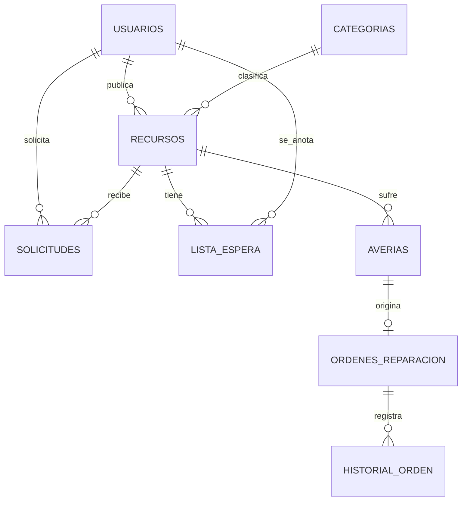

# Base de datos de ReCircula Campus

Esquema para **Supabase** (PostgreSQL administrado), construido a partir de la planificación, el portafolio de modelado (clases, estados, C4, ADR-01) y la práctica integradora.

> **Estado:** ejecutado y verificado en Supabase. Los archivos `01` a `04` corrieron sin errores y `04_tests.sql` devolvió *«Todas las pruebas de la base de datos pasaron»*.

## Archivos y orden de ejecución

Se ejecutan en el **SQL Editor** de Supabase, cada uno en una consulta nueva (botón **+**), en este orden:

| Orden | Archivo | Qué hace |
|---|---|---|
| 1 | `01_schema.sql` | Tablas, restricciones, triggers, funciones de negocio y vistas |
| 2 | `02_supabase_adapter.sql` | Vincula con Supabase Auth, activa RLS y limita permisos |
| 3 | `03_seed_demo.sql` | Datos ficticios y el escenario de la demo (opcional) |
| 4 | `04_tests.sql` | Pruebas de las reglas (opcional) |

Notas de ejecución:

- Si el editor muestra el aviso *Potential issues detected*, elige **Run and enable RLS**.
- `01_schema.sql` y `02_supabase_adapter.sql` se pueden volver a ejecutar sin romper nada.
- `03_seed_demo.sql` es idempotente: si los datos ya existen, no los duplica.
- `04_tests.sql` no usa tablas temporales: crea sus datos dentro de una función, los deshace al terminar y borra sus propias funciones auxiliares. No deja datos de prueba y se puede ejecutar cuantas veces se quiera. Si una prueba falla, el error empieza con `PRUEBA FALLIDA` o `assertion` e indica la regla.

## Modelo



Decisiones que siguen el portafolio:

- **El préstamo no es una tabla:** es una `solicitud` en estado `confirmada`.
- **La disponibilidad no se guarda:** se calcula (`buscar_recursos`, `recurso_esta_disponible`), así nunca queda desactualizada.
- Estados guardados del recurso: `disponible`, `averiado`, `retirado` (HU-11). `prestado` se deriva en la vista `v_catalogo.estado_actual`.
- Estados de la solicitud: `pendiente → confirmada → devuelta`, `pendiente → rechazada`, y `en_espera_mantenimiento` (que recuerda el estado anterior para reactivarla).

## Reglas e historias: dónde se cumple cada una

| Regla / historia | Mecanismo |
|---|---|
| **R1** sin superposición | `EXCLUDE USING gist` sobre `(recurso_id, rango)` para solicitudes confirmadas, más validación y bloqueo de fila en `aprobar_solicitud` |
| **R2** fin ≥ inicio | `CHECK` + trigger con mensaje comprensible |
| **R3** solo propietario/coordinador | `aprobar_solicitud`, `rechazar_solicitud` + RLS (sin `UPDATE` directo) |
| **R4** devolución libera y guarda fecha | `registrar_devolucion` + `CHECK` de coherencia |
| HU-01 publicar recurso | `CHECK` de nombre, FK de categoría, política de inserción |
| HU-02 consultar disponibilidad | `buscar_recursos(categoria, desde, hasta)` |
| HU-03 solicitar préstamo | `INSERT` + trigger (fechas, averiado, retirado, nace `pendiente`) |
| HU-06 reportar avería | `reportar_averia` (el recurso pasa a `averiado`) |
| HU-07 lista de espera | `anotar_en_lista_espera` + `promover_lista_espera` (pasa a `pendiente`, no se aprueba sola) |
| HU-08 orden de reparación | `abrir_orden_reparacion`, `avanzar_orden`, trigger de transiciones e historial inmutable (quién y cuándo) |
| HU-10 panel de impacto | vista `v_panel_impacto` (devuelve ceros si no hay datos) |
| HU-11 retiro por mantenimiento | `retirar_recurso` / `reincorporar_recurso` (conservan las solicitudes) |
| RNF-02 mensajes comprensibles | todas las excepciones están en español |
| RNF-03 control de acceso | RLS + funciones `SECURITY DEFINER` |

La restricción de exclusión **refuerza el ADR-01**: la regla sigue validándose en la API con la función de dominio y con TDD, y la base de datos la protege como segunda barrera.

## Puesta en marcha en Supabase

1. Crea el proyecto en supabase.com (`recircula-campus`). Guarda la contraseña de la base en un gestor de contraseñas, no en el repositorio.
2. Ejecuta `01_schema.sql` y `02_supabase_adapter.sql`.
3. (Demo) ejecuta `03_seed_demo.sql` y `04_tests.sql`. Debe aparecer la fila *«Todas las pruebas de la base de datos pasaron»*.
4. **Authentication → Users**: registra usuarios. Un trigger crea su fila en `usuarios` como solicitante (si el correo coincide con uno del seed, lo vincula). Para el primer coordinador:
   ```sql
   update usuarios set rol = 'coordinador' where correo = 'tu-correo@ejemplo.com';
   ```
   Los demás roles (propietario, coordinador) los asigna un coordinador con `asignar_rol`.
5. Desde el frontend (`web/`) usa **solo la clave pública (publishable/anon)**. La `service_role` o `sb_secret_` nunca va en `web/` ni en el repositorio.
6. Desde la API (`api/`, NestJS + TypeORM) usa la cadena de conexión **Session pooler** (Connect → Session pooler) en una variable `DATABASE_URL` dentro de `.env`, que está en `.gitignore`.

## Cómo sabe la base quién actúa

- **Desde la web con Supabase Auth:** `app_actor()` toma la identidad del JWT (`auth.uid()`). El propietario sale de la sesión, no del body. Con esto desaparece la deuda técnica del README (`propietarioId` lo manda el cliente).
- **Desde la API con `DATABASE_URL`:** la conexión no lleva el JWT del usuario, así que la API indica quién actúa dentro de cada transacción:

```ts
// con TypeORM, dentro de una transacción
await manager.query("select set_config('app.actor', $1, true)", [String(usuarioId)]);
await manager.query('select aprobar_solicitud($1)', [solicitudId]);
```

## Escenario de la demo (con el seed)

1. Ana y Luis piden la Casio en fechas superpuestas (ya cargado, ambas `pendiente`).
2. Carlos (propietario) aprueba la de Ana → `aprobar_solicitud`. Al aprobar la de Luis, falla por superposición.
3. Luis se anota: `anotar_en_lista_espera(<id Casio>, '2026-12-03', '2026-12-07')`.
4. El coordinador registra la devolución → la Casio vuelve a estar disponible y la entrada de Luis pasa a `pendiente`.
5. Avería → `reportar_averia`, `abrir_orden_reparacion`, `avanzar_orden(..., 'en_reparacion')`, `avanzar_orden(..., 'resuelta')`, con fecha y responsable en `historial_orden`.

## Notas

- Las vistas `v_catalogo`, `v_panel_impacto` y `v_usuarios_publicos` aparecen como *UNRESTRICTED* en el panel de Supabase porque las vistas no tienen RLS propio. Es esperado: solo las pueden leer usuarios autenticados, y `v_usuarios_publicos` expone únicamente `id`, `nombre` y `rol`.
- Los mensajes de error que comprueban las pruebas (`check`, `foreign key`, `exclusion`) están en inglés; si el servidor usara otro idioma, habría que ajustar esos tres fragmentos en `04_tests.sql`.
- Al promover la lista de espera se crea una solicitud `pendiente` nueva; la solicitud original de esa persona, si seguía pendiente, no se cancela. Conviene rechazarla en la demo.
- Un recurso con préstamo confirmado a futuro que luego se reporta averiado conserva ese préstamo; cancelarlo automáticamente es una decisión de negocio que conviene registrar en el tablero.
- Próximo paso posible: entidades TypeORM para `api/`.
